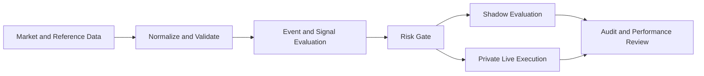

# Prediction Market Infrastructure

**Agiphi | Proprietary research, execution, and risk infrastructure**

This repository is the public-facing technical overview for a proprietary prediction-market infrastructure project. It documents system boundaries, architecture principles, and evidence standards without publishing the production implementation or trading strategy.

## What it is

A research-to-execution architecture designed to separate strategy experimentation from live order execution. The intended workflow combines market-data normalization, event and signal evaluation, risk gating, Shadow evaluation, controlled Live execution, and auditable measurement.

## Conceptual architecture

This is a conceptual diagram. It intentionally omits proprietary strategy logic, thresholds, deployment topology, and sensitive operational details.

## Areas of engineering

- Market-data ingestion and normalization
- Separation of simulation and live execution
- Order lifecycle and reconciliation
- Risk controls and operational safeguards
- Observability and auditable performance measurement
- Potential cross-venue event comparison, subject to contract and settlement equivalence

## Evidence and limitations

This repository describes architecture, not a verified investment track record. No profitability, return, or independently validated alpha claim is made here. Any future performance publication should identify the observation period, strategy version, trade count, realized net P&L after fees, drawdown, and methodology, and should distinguish live results from simulations and backtests.

Win rate alone is not evidence of profitability. A price difference between venues is not necessarily an executable arbitrage; contract terms, resolution rules, fees, liquidity, timing, and execution risk matter.

## Intellectual property

The production implementation, strategy rules, precise thresholds, sizing logic, credentials, private telemetry, and deployment details are not included. Please do not infer exchange affiliation, endorsement, or guaranteed performance.

## Commercial interest

Agiphi may consider appropriate software licensing, private deployment, or technical partnerships. Public availability of this overview does not grant a license to proprietary implementation or strategy IP.

## Contact

For professional background and contact information, see [Precious Agi's infrastructure architecture portfolio](https://preciousagi.agiphi.com/).
