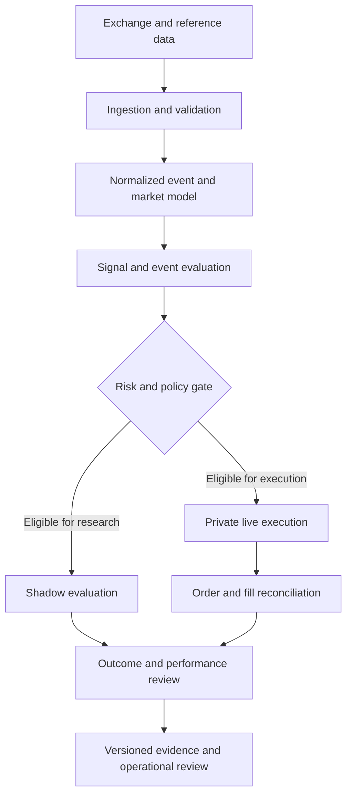

# Prediction-Market Infrastructure: Architecture Case Study

**Publisher:** Agiphi  
**Classification:** Public, sanitized conceptual overview  
**Status:** Architecture reference; not a complete implementation specification

## Objective

Describe a disciplined architecture for researching and operating prediction-market systems while keeping proprietary source code, strategy logic, credentials, and deployment details private.

This document describes architectural boundaries and evaluation principles. It does not claim that every component is implemented, independently audited, or profitable.

## Conceptual architecture

The diagram is conceptual. It intentionally omits vendor-specific services, internal interfaces, strategy rules, exact risk limits, and production topology.

## Architectural boundaries

### 1. Data ingestion and normalization

A system should validate timestamps, identifiers, market status, and data quality before downstream evaluation. When comparing venues, preserve the source and timestamp of each observation rather than treating quotes as perfectly synchronized.

### 2. Event and contract semantics

Markets that appear to refer to the same real-world event may have different resolution sources, cutoffs, wording, or settlement rules. A cross-venue comparison should first establish semantic equivalence; similar labels alone are not enough.

### 3. Research and live execution separation

Research or shadow evaluation should not silently share the authority to submit live orders. The system boundary should make it clear which path is observational and which can create financial exposure.

### 4. Risk and policy controls

Eligibility checks belong before order submission. Their existence is not proof that a system is safe; controls need tests, operational monitoring, failure handling, and review of actual behavior.

### 5. Order lifecycle and reconciliation

A robust review distinguishes an order being created, accepted, partially filled, filled, canceled, rejected, or left unresolved. Performance calculations should be reconciled against authoritative fills and account records, not inferred solely from application logs.

### 6. Observability and evidence

Operational records should support investigation without exposing secrets. Keep a clear separation between internal diagnostics and public performance reporting, and redact credentials, account identifiers, private endpoints, and sensitive order details.

## Evaluation framework

A meaningful performance report should define, at minimum:

- Measurement period and strategy/version identifier
- Number of trades and the source of the records
- Gross and net P&L, with fees and other costs handled explicitly
- Average win, average loss, expectancy, and profit factor
- Maximum drawdown and exposure/concentration measures
- Results by market or regime where sample sizes support interpretation
- Data exclusions, corrections, and methodology
- Whether the result is live, paper, simulated, or backtested

Win rate alone does not establish profitability or robustness. A small sample can be dominated by variance, and a positive result before fees may not remain positive after costs.

## Security and disclosure

The public repository is an architecture portfolio, not a source release. Do not place credentials, API keys, exact strategy rules, private thresholds, sizing logic, production logs, account exports, or sensitive infrastructure details here.

## Limitations

This document is not investment advice, an offer to manage assets, or a representation of verified returns. It does not imply affiliation with or endorsement by any exchange. Any commercial deployment requires a separate review of technical scope, security, platform terms, and applicable law.
