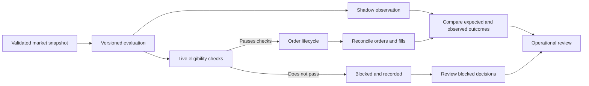

# Live and Shadow Workflow

**Classification:** Public, sanitized conceptual workflow  
**Purpose:** Explain the separation between research observation and live order execution without exposing proprietary implementation details.

## Why separate the paths?

A shadow process can evaluate candidate decisions without submitting orders. A live process can create real exposure and therefore needs stricter controls around authorization, order state, reconciliation, and incident response.

The paths should be compared using the same versioned definitions where practical, while recognizing that live fills, latency, liquidity, fees, and partial execution can produce different outcomes from a shadow estimate.

## Conceptual workflow

This is a reference model, not a statement that the production system follows these exact internal steps.

## Comparison dimensions

| Dimension | Shadow evaluation | Live execution |
|---|---|---|
| Financial exposure | None from the shadow decision itself | Real exposure may occur |
| Price basis | Depends on recorded market observations and assumptions | Actual accepted orders and fills |
| Costs | Must be modeled and labeled | Must use actual fees and realized execution costs where available |
| Order behavior | Cannot prove actual exchange execution | Requires order-state and fill reconciliation |
| Primary question | Would the decision have met the defined rules? | What actually happened after submission? |

## Minimum evidence for a fair comparison

1. Identify the strategy/configuration version and the exact measurement window.
2. Use a consistent market and event inclusion policy.
3. Preserve timestamps and label stale or missing observations.
4. Record the assumptions used for hypothetical fills; do not present them as actual fills.
5. Reconcile live results against authoritative account/order records.
6. Report fees, slippage assumptions, rejected orders, partial fills, and unresolved orders transparently.
7. Separate live, paper, simulation, and backtest results in every public summary.

## Interpretation cautions

- A high win rate can coexist with negative expectancy.
- Shadow results do not establish that live execution would have received the same prices or fills.
- A profitable short period does not establish durable performance.
- Cross-venue price differences are not guaranteed arbitrage; settlement terms, fees, depth, latency, and execution constraints matter.

## Disclosure boundary

This document intentionally excludes strategy conditions, exact thresholds, sizing formulas, internal code, API details, credentials, production topology, and private operational telemetry.
